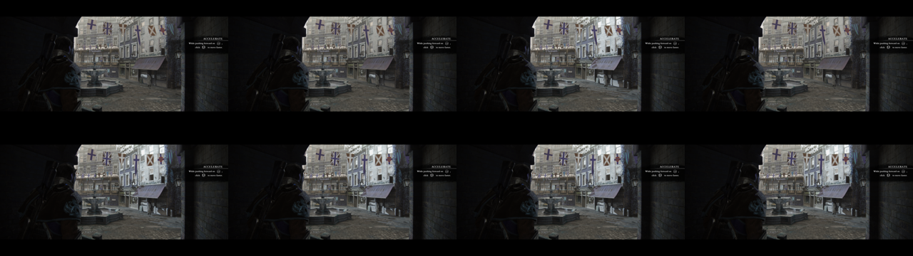

# Issue #64: sun and shadows drop out on 3 of every 4 frames (sun-sync snapshot order), 2026-11-24

Issue: DivinusX/a-port-of-the-order-1886-thats-actually-alive#64 (Radeon 890M / RADV STRIX1,
v0.2.46 and v0.2.51: "flickering in cutscenes and on certain objects", walls, faces, shadows).

## What the reporter's clips show

Measured frame by frame, the 1440p cutscene clip has single-frame lighting drop-outs: the
characters' faces and coats lose their key light for one frame, then it comes back. The
gameplay clip in Whitechapel loses the sun on facades and cobbles the same way.

## Reproduced on an RTX 5050 (NVIDIA), no special settings

Whitechapel checkpoint (Continue), 60 fps, defaults (`sun sync 1`, `htile expand 1`). A
40-frame consecutive dump of the display buffer (mean luma per frame):

| build / setting | 40 consecutive frames |
| --- | --- |
| HEAD, sun sync 1 (default) | `35.4 35.4 38.9 35.7 \| 35.6 35.6 39.0 35.8 \| ...`: sun on **1 frame in 4** |
| HEAD, sun sync 0 | 38.1-38.7, steady, sun on |
| HEAD, sun sync 2 (drain) | 35.3-35.7, steady, sun **off** |
| HEAD, sun sync 1, htile expand 0 | 31.4 / 44.8 alternating, worse |
| **fix**, sun sync 1 (default) | **38.1-38.7, steady, sun on** |
| **fix**, sun sync 1 + `ORDER1886_GC_BUDGET_MB=3000` (iGPU rule) | **38.2-38.5, steady, sun on** |

Without the fix, the forced iGPU memory rule (`ORDER1886_GC_BUDGET_MB`) made the flicker
much more visible (37 <-> 29 in screenshot bursts). Slower GPUs get it worse, which is why
the 890M handheld shows it everywhere.

## Cause

`RecordSunCopies()` was recorded **before** `BindResources` and the dispatch of
`0x7b1b18c9`. That shader is one of the two that write the sun depth-range slots, and the
log shows the game's CPU resetting a neighbouring slot every frame
(`Readback sync: CPU write at 0x...85520`). A sun-sync trace showed every CPU fault served
the batch two ticks old (5544 of 5546). Because the copy was taken before the dispatch ran,
that batch held the slot in its reset state instead of the fitted range. The cascades were
fit to it, and the sun dropped out on three frames of every four.

## Fix

`vk_rasterizer.cpp` `DispatchRecord`: record the sun snapshot after the dispatch, right after
`ResetBindings(true)`. That call registers the dispatch's buffer writes with the barrier
tracker, so the staging copy gets its compute-to-transfer barrier from `Runtime::CopyBuffer`.
The ranges `BindResources` registers on the first frame are now covered on that frame too.

Staging delivery itself is unchanged (4964 faults served from completed batches in the fixed
run, 2 `nobatch` at load).

## Not verified here

- Not run on an RDNA3.5 iGPU (890M). The reporter's retest on v0.2.53 is the confirmation.
- The Chase (Chapter II, the v0.2.17 scene) not re-run; the delivery path it relies on is
  unchanged, and only the snapshot point moved.
